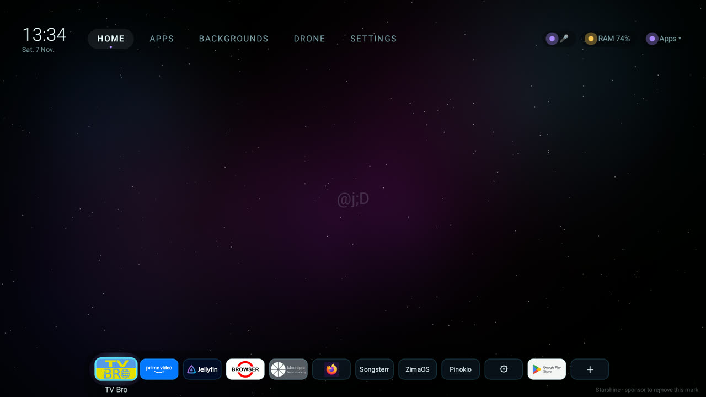
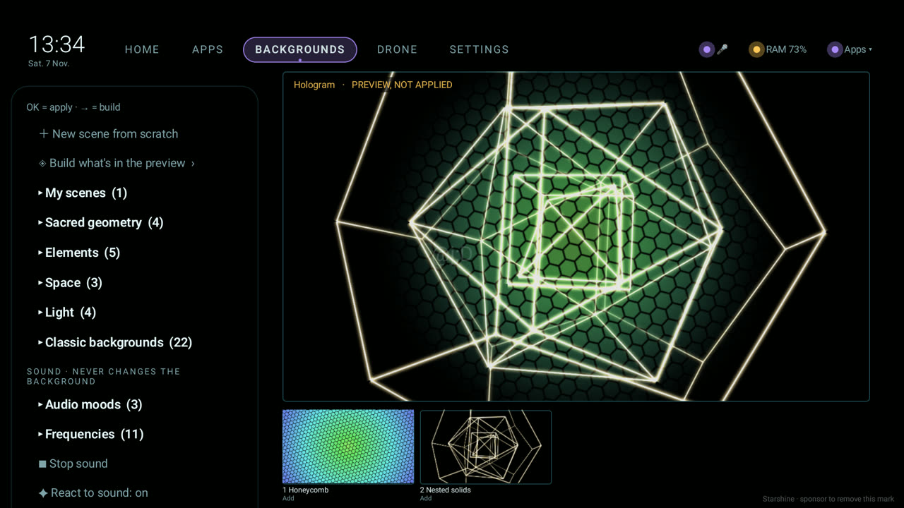
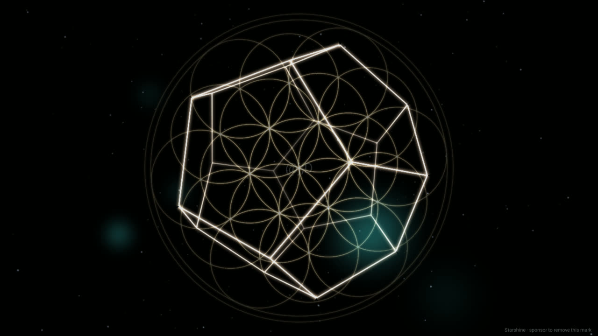
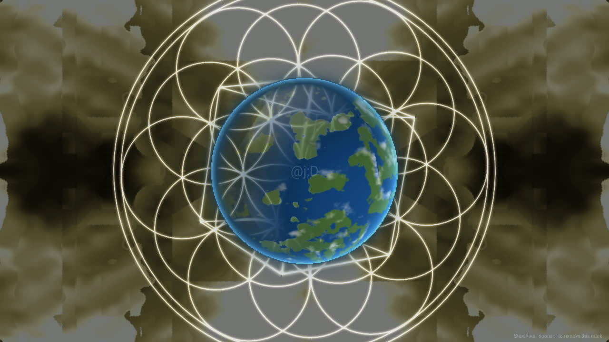
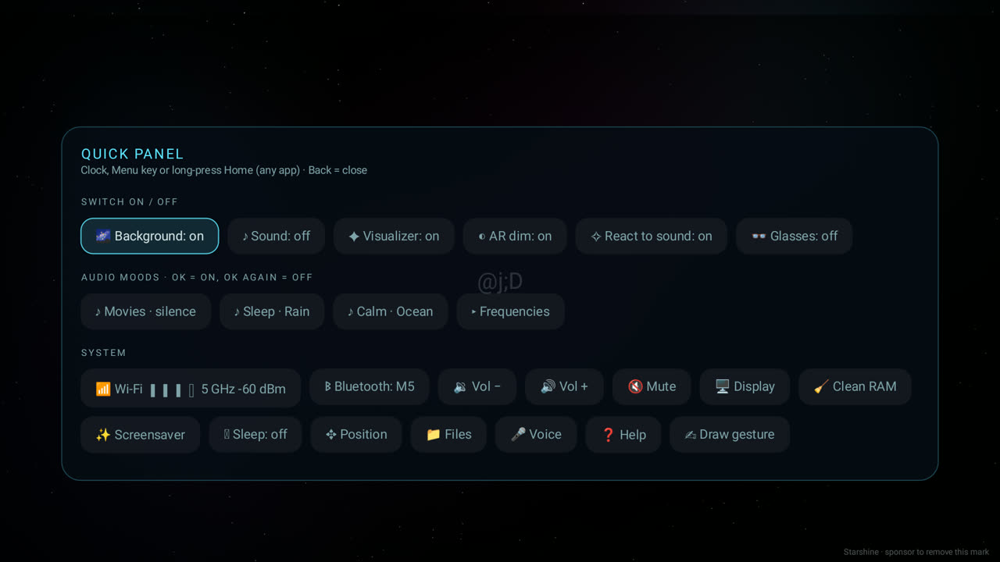

# Starshine help

Starshine is a home screen for Android TV boxes, made for AR glasses such as Rokid. Black is see-through on these glasses, so the interface is glowing elements on true black. It adds layered animated backgrounds, sound moods, a frequency generator, a file explorer and more.

This help is the same file on GitHub and inside the app (Quick panel → Help, or Settings → About & exit → Help).

## Using the remote

| Button | What it does |
|---|---|
| Arrows | Move the selection. Hold half a second to keep moving |
| OK | Open or engage the selected item |
| Hold OK | Extra actions, such as moving a dock tile |
| Back | Close the last thing you opened |
| Menu | Quick panel |
| Mic or search | Voice command |

On a setting, OK starts editing it (amber), ← → change the value, and ↑ ↓ go straight to the next setting.

**Air mouse:** a click acts on the item under the cursor if you moved the cursor there last, otherwise on the selected item. Right click is Back. Hold the right button and draw to make a gesture.

## Home

The dock holds your apps. The first app is selected when Starshine opens.

- Hold OK on a tile, then ← → to move it or ↓ to remove it.
- The **+** tile adds apps and web shortcuts.
- The dock and top menu slide away when idle; any press brings them back.
- If you use Jellyfin, a Continue watching row can appear (Settings → Web & Jellyfin).

## Backgrounds

The Backgrounds tab is a workspace. The monitor previews the scene you're browsing, with every layer as a live tile underneath, from back to front. Your real background doesn't change until you apply. The label says **PREVIEW, NOT APPLIED** or **ON SCREEN**.

- **OK** on a scene applies it. **→** opens it in the builder.
- **＋ New scene from scratch** starts empty.
- **Classic backgrounds** are single animated backgrounds. Browsing shows one full screen without applying it. OK applies it; → opens its settings.
- Scenes come in folders: My scenes, Sacred geometry, Elements, Space, Light.

### Building a scene

Each layer shows as a live tile under the preview, from left (back) to right (front). Up to 8 layers can be stacked. Opening a scene puts you on its first layer, and the panel shows the settings of the layer you're on.

On a layer tile:

| Button | What it does |
|---|---|
| ← → | Next layer to the left or right |
| OK | Show only this layer in the preview (green). OK again returns to the whole scene |
| Hold OK | Pick it up: ← → move it, OK drops it, the same as a dock app |
| ↑ | Go to its settings. → or Back returns to the tile |
| Back | Scene options: apply, full-screen preview, add a layer, save, reset |

**＋ Add layer** lists every type, by category:

- **Classic backgrounds:** added as the first (back) layer.
- **Line visualizers:** sine waves, Lissajous, kaleidoscope, spiral, flow.
- **Sacred geometry:** Flower of Life, Seed of Life, Metatron's Cube, floral mandala, golden spiral, hex lattice.
- **3D solids:** tetrahedron, cube, octahedron, icosahedron, dodecahedron, star tetrahedron, nested solids, torus.
- **Particles:** starfield, orbs, dust.
- **Fields and light:** clouds, fire, water, nebula, iris, sun flare, candle, globe, honeycomb, aether.
- **Your files:** an image or video.

Settings in a node:

- **Blend:** Add, Screen, Normal, Multiply.
- **Mirror:** left-right, 4-way, diamond, or kaleidoscope with 6, 8 or 12 segments.
- **Mask by** and **Warp by:** another layer shapes or bends this one. The tile shows the link, such as "mask 2". Set "In the picture" to "source only" to use a layer just as a mask or warp.
- **Look:** opacity, size, speed, rotation speed, angle, tilt, color, color drift, saturation, glow, detail, edge fade, trails, position.

**Image and video nodes** are flat on the screen by default. **View** switches to Perspective with real 3D tilt. **Fit** chooses Fill screen or Whole picture. **Placement** has position, size, angle and rotation speed.

Save with **Save as new scene** or **Save changes**. **Reset to its saved state** undoes your edits. Built-in scenes always start from their defaults.

### Reacting to sound

Each node has two reaction slots: a source (Voice, Level, Bass, Mid, High, Beat, Swell) and what it changes (Glow, Opacity, Spin, Size, Color, Warp, Detail, Fade). Voice follows speech and chanting. Swell is a slow average. Beats are limited to 2 per second to stay comfortable for photosensitive viewers.

Starshine tries to read the device's sound output. Where the system doesn't allow that, reaction follows the settings of the playing mood instead.

### Exporting video

**Export preview as 15 s video** saves a 720p MP4 to `Movies/Starshine`, where VLC and other players can find it. Sound reaction isn't recorded.

## Sound

**Audio moods** never change the background: Movies (silence), Sleep (rain), Calm (ocean). Press OK to start one and OK again to stop it. Sound pauses when another app plays audio and resumes afterwards.

### Frequency generator

Pure tones, binaural beats, isochronic pulses, sweeps, harmonics and a pink-noise bed. Presets can be saved and deleted. Binaural beats need stereo, and it's best to keep the volume low.

**Didgeridoo:** turn it on to reveal drone note, level, mouth movement, mouth speed and breath. "Hide the tone" lets you hear it alone. Turning it off hides these settings.

These sounds are for relaxation only and make no health claims.

## Quick panel

Open it with the clock, the Menu key, or a long press on Home in any app.

It has switches for background, sound, visualizer, AR dim, sound reaction, glasses mode and each layer of the current scene, plus audio moods and system shortcuts.

## Settings

- **Display & position:** global AR dim, graphics quality (540p, 720p, 1080p), dock size, auto-hide, zoom, position, and **Reset layout to full screen**.
- **Theme:** color presets, a generator for new color pairs, accent and ring colors, panel background, dimming behind menus, 4 fonts.
- **Drone:** show or hide the Drone menu, and the drone picture settings.
- **Files:** the file explorer.
- **Sound, Voice setup, M5 air mouse, Gestures, Web & Jellyfin, Screensaver, Dock, System, About & exit.**

Graphics quality applies to layered scenes and GPU backgrounds. Higher is sharper and can lower the frame rate, so try 720p first.

**AR dim** darkens the whole picture toward see-through. It's one global setting; scenes and moods don't change it.

## Files

Settings → Files, or the Quick panel. **All videos on this pod** lists every video Starshine can find. USB drives appear too. Android doesn't let apps read other apps' private folders.

On a file you can play it in VLC or another app, use it as the background, add it as a layer, copy it to `Movies/Starshine`, or delete it (it asks twice).

To send files from a PC, use **Send Video to Pod** in the Pinokio toolkit.

## Voice commands

Press the mic key or the 🎤 pill, then say for example "open Jellyfin", "mood calm", "play rain", "volume up" or "sleep in 30". Settings → **Voice setup** checks the permission and microphone, chooses the recognizer, and tests it live with the exact error if it fails.

## Gestures

With an air mouse, hold the right button and draw. Shapes are read in 8 directions (→ ← ↑ ↓ ↗ ↘ ↙ ↖), and each can open an app, change the background, play a mood or open a panel. Set them up in Settings → Gestures.

## Drone (experimental)

Live video from Wi-Fi toy drones that use the KY UFO app (network name `FLOW-UFO-...`). **It doesn't work yet on every drone; the video connection is still being developed.**

- **Connect** joins the drone's Wi-Fi. While connected, the device has no home network or internet. Disconnect, or leaving the tab, returns it to home Wi-Fi.
- The background is off in this tab, and the drone has its own AR dim.
- **Immersive view** hides all menus; any button returns.
- You can hide the menu in Settings → Drone.

Starshine only shows video. It never sends flight commands. Fly by direct line of sight, and follow your local drone rules.

## PC toolkit (Pinokio)

The Pinokio launcher controls the device from your PC over Wi-Fi ADB:

| Item | What it does |
|---|---|
| Connect | Connects to the device and remembers its address |
| Mirror on PC | Shows and controls the screen with scrcpy |
| Build & Install Starshine | Builds the app from source and installs it |
| Sideload APK | Installs APK files |
| Send Video to Pod | Copies videos and images to the device |
| Voice Setup | Grants the microphone and reports recognizer status |
| M5 Remote / Pointer | Detects remotes and sets pointer speed |
| Device and RAM reports, Net Check, Tweaks | Diagnostics and reversible system tweaks |
| Enter Support Key | Enters a support key without typing it on the remote |

## Troubleshooting

- **"device offline" or no connection:** make sure the device is awake and on the same network, then run Connect again.
- **Home button opens the old launcher:** Toolkit → Tweaks → Home = Starshine, or see Settings → System.
- **Layout looks wrong in the glasses:** Settings → Display & position → Reset layout to full screen, then adjust.
- **Choppy backgrounds:** lower Graphics quality, use fewer nodes, or fewer soft fields like clouds and fire.
- **Voice fails:** Settings → Voice setup shows the reason.

## Privacy

Starshine has no accounts, ads or analytics. Settings stay on the device. It connects only to what you use: your Jellyfin server, web shortcuts and the drone. The microphone is used only during a voice command, and sound reaction only measures levels, without recording.

## Support the project

If you own Rokid or other AR glasses and find this useful, please **star the repo** on GitHub. A US$10 contribution gets you a support key that removes the watermarks: see [Sponsors](https://github.com/sponsors/jdeschambeault-code), then enter the key in Settings → About & exit.
