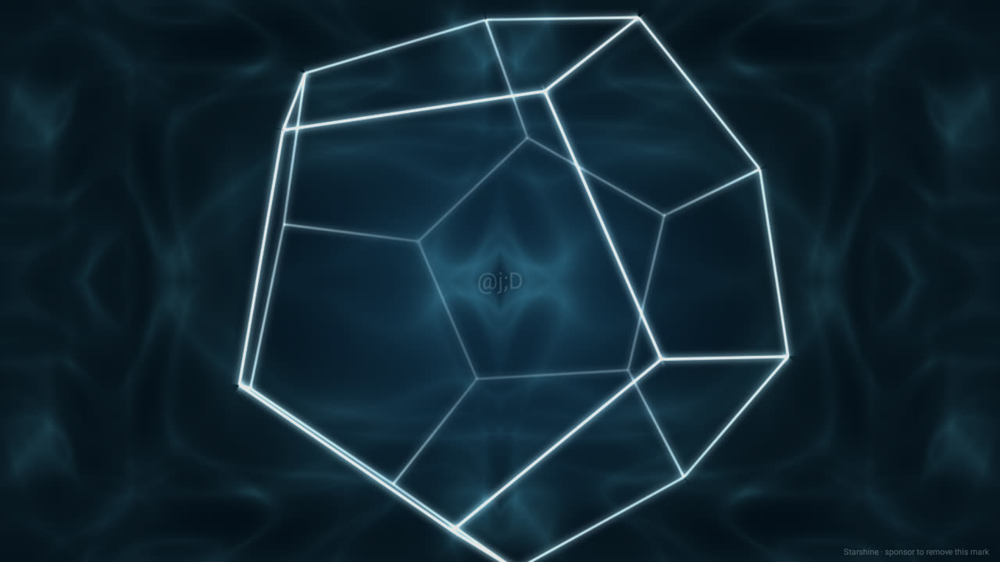
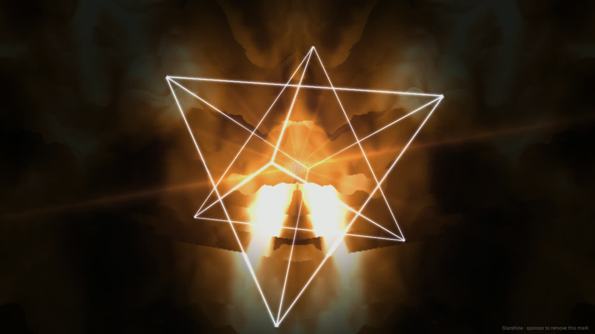
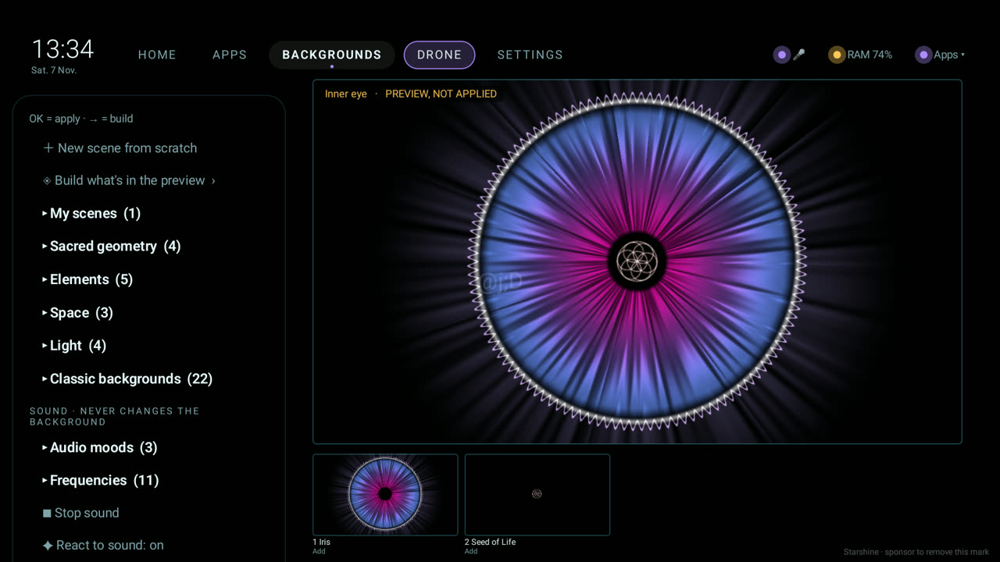

# Starshine help

Starshine is a home screen for Android TV boxes, made for AR glasses such as Rokid. Black is see-through on these glasses, so the interface is glowing elements on true black. It adds layered animated backgrounds, sound moods, a frequency generator, a file explorer and more.

This help is the same file on GitHub and inside the app (Quick edit → About & exit → Help).

## Using the remote

| Button | What it does |
|---|---|
| Arrows | Move the selection. Hold half a second to keep moving. At the end of a menu, a new press loops to the other end |
| OK | Open or engage the selected item |
| Hold OK | A menu of what you can do with the selected item |
| Back | One level up: close what you opened, then go to the current tab in the top menu, then to Home |
| Menu, if your remote has one | Quick edit |
| Mic or search | Voice command |

On a setting, OK starts editing it (amber), ← → change the value, and ↑ ↓ go straight to the next setting.

**Air mouse:** a click acts on the item under the cursor if you moved the cursor there last, otherwise on the selected item. Right click is Back. Hold the right button and draw to make a gesture.

## Home

The selection starts on the clock in the top menu, so ← → move through Home, Apps, Backgrounds, Meditation and the rest. Press ↓ to go down to the dock, which holds your apps.

- Hold OK on a tile to open, move or remove it. While moving, ← → move it, ↓ removes it and OK finishes.
- The **+** tile adds apps and web shortcuts.
- The dock and top menu slide away when idle; any press brings them back.
- If you use Jellyfin, a Continue watching row can appear (Settings → Web & Jellyfin).

## Bg/Moods Generator

One tab with two sub-tabs, **Backgrounds** and **Moods**. Both work the same way: browse, OK to apply, → to build.

### Backgrounds

The Backgrounds tab is a workspace. The monitor previews the scene you're browsing, with every layer as a live tile underneath, from back to front. Your real background doesn't change until you apply. The label says **PREVIEW, NOT APPLIED** or **ON SCREEN**.

- **OK** on a scene applies it. **→** opens it in the builder.
- **＋ New scene from scratch** starts empty.
- **Classic backgrounds** and your own files are scenes too, each starting as one layer, so you can build on them like any other scene.
- Scenes come in folders: My scenes, Sacred geometry, Elements, Space, Light.

### Building a scene

Each layer shows as a live tile under the preview, from left (back) to right (front). Up to 8 layers can be stacked. Opening a scene puts you on its first layer, and the panel shows the settings of the layer you're on.

On a layer tile:

| Button | What it does |
|---|---|
| ← → | Next layer to the left or right |
| OK or ↑ | Go to its settings |
| Hold OK | A menu: settings, move, turn on or off, show only this, duplicate, remove. In Move, ← → move it and OK drops it |
| Back | Scene options: apply, full-screen preview, add a layer, save, reset |

**＋ Add layer** shows every type as an icon, four to a row, in folders that open with OK. The panel's header names the selected icon. An icon lights up green once that layer is in the scene. OK on a green icon offers **Remove it** (selected first, so it's a quick undo), **Add another** or **Cancel**. Audio moods work the same way, with a small wave as each icon.

While Add layer is open, the layer tiles can't be selected. → or Back closes it.

**A layer's settings** start with two rows, then collapsible sections: Basics, Position, Color & light, Mixing, Links to layers, React to sound and Layer actions.

- **Layer: On / Off** is saved with the scene.
- **Preview: Whole scene / Only this** only changes the preview, and Apply still uses every layer. A banner shows while it's on.
- **Sections:** one is open at a time. OK or → opens one, ← closes it, and a closed one sums up what's inside. The open section stays open as you move between layers.
- **Values:** ↑ ↓ moves, ← → changes the value, and **Back** returns to the tile. To press OK before changing a value, turn on **Lock setting while editing** in Settings → M5 air mouse.
- **Used as: Hidden source** (in Links to layers) keeps a layer out of the picture while another layer masks or warps with it.

Your work is saved temporarily as you build, one scene and one mood at a time. Leave with Home and the builder reopens when you come back to the tab. Otherwise, **↩ Resume unsaved** is at the top of the list, with **Discard unsaved** under it. A new unsaved scene or mood replaces the previous temporary one.

Scenes and moods show as icons, four to a row, in folders you can close. The line at the top names the selected one, and the preview sits beside the menu at whatever size fits. The first option is always **✓ Apply** (or **▶ Play** for moods), and ↓ from the Backgrounds or Moods tab lands on it. On an icon, ← → and ↑ ↓ move, and OK applies or plays it.

Hold OK on a scene to apply it to the background, save it to My scenes (as your own copy), edit it, rename it or delete it. Hold OK on a mood to edit, rename or delete it. Hold OK on a classic background to apply it, save it to My scenes or edit it. Renaming one of your scenes or any mood updates the journeys that use it. Renaming a built-in scene makes your own copy.

The categories:

- **Classic backgrounds:** added as the first (back) layer.
- **Line visualizers:** sine waves, Lissajous, kaleidoscope, spiral, flow.
- **Sacred geometry & solids:**
  - Sacred figures: Flower of Life, Seed of Life, Metatron's Cube, floral mandala, golden spiral, hex lattice, Vesica piscis, Sri Yantra, Tree of Life, hexagram, pentagram, enneagram, phyllotaxis, Fibonacci squares.
  - All 5 Platonic solids, all 13 Archimedean solids and all 4 Kepler-Poinsot star solids, plus the star tetrahedron and nested solids.
  - Prisms, antiprisms and a selection of Johnson solids.
  - Curved: sphere, cylinder, cone, torus, Möbius strip, Klein bottle, trefoil knot.
  - Higher dimensions, projected down to 3D, with a **Dimensions** setting: hypercube up to 10D, simplex and cross-polytope up to 26D.
- **Particles:** starfield, orbs, dust.
- **Fields and light:** clouds, fire, water, nebula, iris, sun flare, candle, globe, honeycomb, aether.
- **Your files:** an image or video.

Settings in a node:

- **Blend:** Add, Screen, Normal, Multiply.
- **Mirror:** left-right, 4-way, diamond, or kaleidoscope with 6, 8 or 12 segments.
- **Mask by** and **Warp by:** another layer shapes or bends this one. The tile shows the link, such as "mask 2". Set "In the picture" to "source only" to use a layer just as a mask or warp.
- **Look:** opacity, size, speed, rotation speed, angle, tilt, color, color drift, saturation, glow, detail, edge fade, trails, position.

**Image and video nodes** are flat on the screen by default. **View** switches to Perspective with real 3D tilt. **Fit** chooses Fill screen or Whole picture. **Placement** has position, size, angle and rotation speed.

Save with **Save as new scene** or **Save changes**. **Reset to its saved state** undoes your edits. Built-in scenes always start from their defaults.

### Reacting to sound

Each node has two reaction slots: a source (Voice, Level, Bass, Mid, High, Beat, Swell) and what it changes (Glow, Opacity, Spin, Size, Color, Warp, Detail, Fade). Voice follows speech and chanting. Swell is a slow average. Beats are limited to 2 per second to stay comfortable for photosensitive viewers.

Starshine tries to read the device's sound output. Where the system doesn't allow that, reaction follows the settings of the playing mood instead.

### Exporting video

**Export preview as 15 s video** saves a 720p MP4 to `Movies/Starshine`, where VLC and other players can find it. Sound reaction isn't recorded.

## Sound

**Audio moods** never change the background: Movies (silence), Sleep (rain), Calm (ocean). Press OK to start one and OK again to stop it. Sound pauses when another app plays audio and resumes afterwards.

### Frequency generator

Pure tones, binaural beats, isochronic pulses, sweeps, harmonics and a pink-noise bed. Presets can be saved and deleted. Binaural beats need stereo, and it's best to keep the volume low.

**Didgeridoo:** turn it on to reveal drone note, level, mouth movement, mouth speed and breath. "Hide the tone" lets you hear it alone. Turning it off hides these settings.

These sounds are for relaxation only and make no health claims.

## Visual Meditation

**🔬 Play it with the audio test** plays the journey and records what happens to the sound. It writes a report, a second-by-second table and a recording of the generated sound to `Android/data/com.starshine.launcher/files/audiotest` and shows a one-line result.

A journey is a timeline of scenes and sound that blends from one step to the next. Open the **Meditation** tab to plan one, or start it from the Quick edit.

- **Timeline:** under the preview, the journey is plotted in time. Width follows duration, and shading shows the blends. Below it are the video layers and the audio layers of the selected step.
- **Transitions:** Cross dissolve, Dip to black, Luma dissolve, Wipe, Iris or Spiral. **A step's transition mixes out of the previous background into that step. It never affects the next step**, which has its own. On step 1 it mixes out of the background on screen when you press play, or cuts straight in if that's a classic background or a file. Both keep running during the mix, and the transition is centred on the cut, so a 15 s blend starts 7.5 s before the previous step ends. **Leads with layer** makes the transition follow one layer's brightness and brings that layer in first. **Layer offset** brings the other layers in one after another.
- **Steps:** each has a scene, a mood and a time (in 0.1-minute steps). Browsing a step shows its scene in the preview. OK opens it to edit, move or remove it.
- **Play:** the journey takes over the background, and the Quick edit has pause, next step and stop.

### Moods

The **Moods** sub-tab builds a sound from layers: Tone, Noise, Didgeridoo, Singing bowl, Tibetan bells, Xylophone, Chimes, Temple gong, Tanpura, Handpan, Kalimba, Frame drum, Rain and Ocean. All are synthesized live, inspired by those instruments rather than recorded from them. Ready-made layered moods are in the **Meditative** and **World-inspired** folders, to listen to or rebuild. Browsing shows a mood's layers under the preview, each as a tile with a small wave and its name. OK plays a mood, and → opens the builder.

On a layer tile: ← → next layer, OK or ↑ goes to its settings, hold OK opens its menu (settings, move, on or off, hear only this, duplicate, remove), and Back returns. Settings work as for scenes, with **Hear: Whole mood / Only this** instead of Preview. On Carrier and Beat, OK changes how far each arrow press moves the value. **＋ Add layer** works the same as for scenes: icons with the same on/off choice. Save with **Save as new mood** or **Save changes**.

Tone layers can change slowly:

- **Fine steps:** carrier and beat adjust down to 0.001 Hz.
- **Slowly moves to:** glide the carrier or beat to a new value over the minutes you choose.
- **Living motion:** the carrier and level drift without a repeating pattern, to avoid a cyclic feel. Both ears move together, so the beat you chose stays exact.
- **Follows the visuals:** brighter scenes raise the carrier, so the picture shapes the sound.

The other direction works through a layer's React settings: the **Tone beat** and **Tone pitch** sources make visuals follow the playing frequency directly. On-screen pulsing stays at 2 per second or less, even for a 40 Hz beat.

## Quick edit

Open it with the clock, a long press on Home in any app, or the Menu button if your remote has one.

Quick edit works like a phone's control center:

- **Tiles:** Wi-Fi, Bluetooth, Mute, Background, Sound, AR dim, React to sound, Glasses, Sleep, Screensaver, Clean apps, Browser and Draw gesture. A lit tile is on.
- **Sliders:** Volume, Brightness and AR dim level. ← → changes them. Some TV boxes ignore the brightness setting, and the first change may ask for permission.
- **Settings:** every settings category is here, and there's no separate Settings tab. "Settings → Sound" in this help means Quick edit → Sound.
- **Presets:** Meditation, Moods and Scenes, shown as icons in sections you can open and close. OK starts one.

It has switches for background, sound, AR dim, sound reaction, glasses mode and each layer of the current scene, plus audio moods and system shortcuts.

## Settings

- **Display & position:** global AR dim, phone screen black after 30 s, graphics quality (540p, 720p, 1080p), dock size, auto-hide, zoom, position, and **Reset layout to full screen**.
- **Theme:** color presets, a generator for new color pairs, accent and ring colors, panel background, dimming behind menus, 4 fonts.
- **Drone:** show or hide the Drone menu, and the drone picture settings.
- **Files:** the file explorer.
- **Sound, Voice setup, M5 air mouse, Gestures, Web & Jellyfin, Screensaver, Dock, System, About & exit.**

**Phone screen black:** when Starshine runs on glasses connected to a phone, this blacks out the phone's own screen after 30 seconds without input. Android doesn't let an app switch the panel off, so it's a black window at lowest brightness, which on an OLED phone looks and saves about the same. A touch brings it back.

Graphics quality applies to layered scenes and GPU backgrounds. Higher is sharper and can lower the frame rate, so try 720p first.

**AR dim** darkens the whole picture toward see-through. It's one global setting; scenes and moods don't change it.

## Files

Settings → Files, or the Quick edit. **All videos on this pod** lists every video Starshine can find. USB drives appear too. Android doesn't let apps read other apps' private folders.

The explorer has places on the left, the folder in the middle as a list or icons, and a preview on the right. The preview also shows what's inside a folder without opening it.

- **On a file:** press OK to play it in VLC or another app, use it as the background, add it as a layer, copy, move, rename or delete it (delete asks twice).
- **On a folder:** OK opens it. Inside it, **⋯ This folder** lets you copy, move, rename or delete it, or add it to Places.
- **Several files:** on each file choose **☑ Select**. Copy, Move and Delete then appear at the top.
- **Top buttons:** Up, list or icons, sort by name, date, size or type, search this folder and below, new folder, and show hidden files.
- **Pasting** never replaces a file. If the name is taken, the new one gets "copy" added to its name.

Network shares (NAS) aren't supported yet.

## Video

Videos play in **VLC** when it's installed, and Starshine has a simple built-in player for devices without it.

**Starshine browser** is in Apps, in the Quick edit (**🌐 Web browser**) and in Settings → Web & Jellyfin. Another browser can send it a page through Share or "open with".

- **Top bar:** back, forward, reload, the address (OK to type an address or search), ☆ to save the page, and ≡ for the menu. On the remote, press up from the top of the page to reach it.
- **≡ menu:** bookmarks, history, downloads, desktop site, text size, the VLC hand-off, and clearing your browsing data. In bookmarks and history, hold OK on an entry to open or remove it.
- **Keys:** **Menu** plays a video found on the page in VLC, or opens the menu when there is none. Hold **Menu** to type an address. **Back** closes the menu, leaves full screen or the top bar, then goes to the previous page.
- **Downloads** ask first and go to your Downloads folder. A video link also offers **Play in VLC**.
- **Privacy:** history and bookmarks stay on this device and are left out of Android backups. Sites can't use the camera, microphone or location. A site that wants protected video asks once per visit.
- **Not included:** tabs. Each link opens in the same page.

**From another browser:** long-press Home. If Starshine can read the page's address, the Quick edit offers **▶ Open this page in Starshine browser**. If the browser hides its address bar, show it first. The address is read only on that long-press and kept only until the panel closes. Password fields are skipped.

When a video with sound starts and its address can be played directly, it opens in VLC by itself. You can turn this off in Settings → Web & Jellyfin. If the video is inside an embedded player, a banner appears instead: press **Menu** to play it in VLC. Short clips and muted page banners are ignored.

Protected video (DRM) and players that build the video inside the page, such as YouTube and Netflix, stay and play in the browser. Some sites refuse VLC because it can't use your login to the site. Android doesn't let any app take over video playing inside other apps.

## Voice commands

Press the mic key or the 🎤 pill, then say for example "open Jellyfin", "mood calm", "play rain", "volume up" or "sleep in 30". Settings → **Voice setup** checks the permission and microphone, chooses the recognizer, and tests it live with the exact error if it fails.

## Gestures

With an air mouse, hold the right button and draw. Shapes are read in 8 directions (→ ← ↑ ↓ ↗ ↘ ↙ ↖), and each can open an app, change the background, play a mood or open a panel. Set them up in Settings → Gestures.

## Drone (experimental)

Live video from Wi-Fi toy drones with an RTSP camera, such as those using the KY UFO app (network name `FLOW-UFO-...`).

- **Connect** joins the drone's Wi-Fi. While connected, the device has no home network or internet, because it can only join one Wi-Fi network at a time. Disconnect, or leaving the tab, returns it to home Wi-Fi.
- **Other drones:** set the start of its Wi-Fi name in the Drone settings. The stream address is found automatically, or you can type it. There's no standard across drones, so ones that don't use RTSP won't work yet.
- The background is off in this tab, and the drone has its own AR dim.
- **Immersive view** hides all menus; any button returns.
- **VR dual view** shows the picture side by side for each eye, with an adjustable eye distance. Use it with glasses set to their 3D side-by-side mode.
- **Record video** saves an MP4 to `Movies/Starshine`. The camera has no sound.
- You can hide the menu in Settings → Drone.

Starshine only shows video. It never sends flight commands. Fly by direct line of sight, and follow your local drone rules.

## PC toolkit (Pinokio)

The Pinokio launcher controls the device from your PC over Wi-Fi ADB:

| Item | What it does |
|---|---|
| Connect | Connects to the device and remembers its address |
| Mirror on PC | Shows and controls the screen with scrcpy |
| Build & Install Starshine | Builds the app from source and installs it |
| Sideload APK | Installs APK files |
| Send Video to Pod | Copies videos and images to the device |
| Voice Setup | Grants the microphone and reports recognizer status |
| M5 Remote / Pointer | Detects remotes and sets pointer speed |
| Force Close Apps | Fully closes the apps you installed. Starshine's own cleaning can only ask Android to close them, so some stay or restart |
| Device and RAM reports, Net Check, Tweaks | Diagnostics and reversible system tweaks |
| Enter Support Key | Enters a support key without typing it on the remote |

## Troubleshooting

- **"device offline" or no connection:** make sure the device is awake and on the same network, then run Connect again.
- **Home button opens the old launcher:** Toolkit → Tweaks → Home = Starshine, or see Settings → System.
- **Layout looks wrong in the glasses:** Settings → Display & position → Reset layout to full screen, then adjust.
- **Choppy backgrounds:** lower Graphics quality, use fewer nodes, or fewer soft fields like clouds and fire.
- **Voice fails:** Settings → Voice setup shows the reason.

## Privacy

Starshine has no accounts, ads or analytics. Settings stay on the device. It connects only to what you use: your Jellyfin server, web shortcuts and the drone. The microphone is used only during a voice command, and sound reaction only measures levels, without recording.

## Support the project

If you own Rokid or other AR glasses and find this useful, please **star the repo** on GitHub. A US$10 contribution gets you a support key that removes the watermarks: see [Sponsors](https://github.com/sponsors/jdeschambeault-code), then enter the key in Settings → About & exit.
