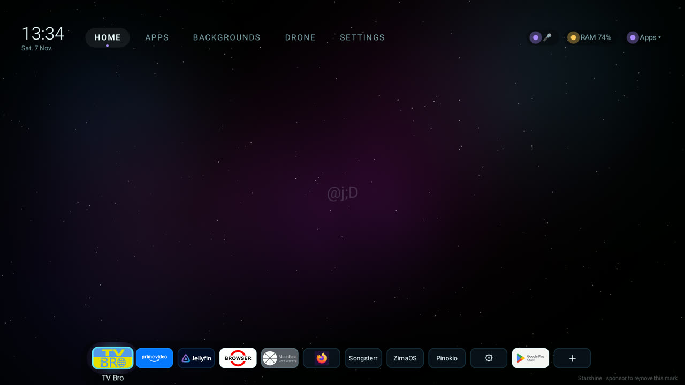
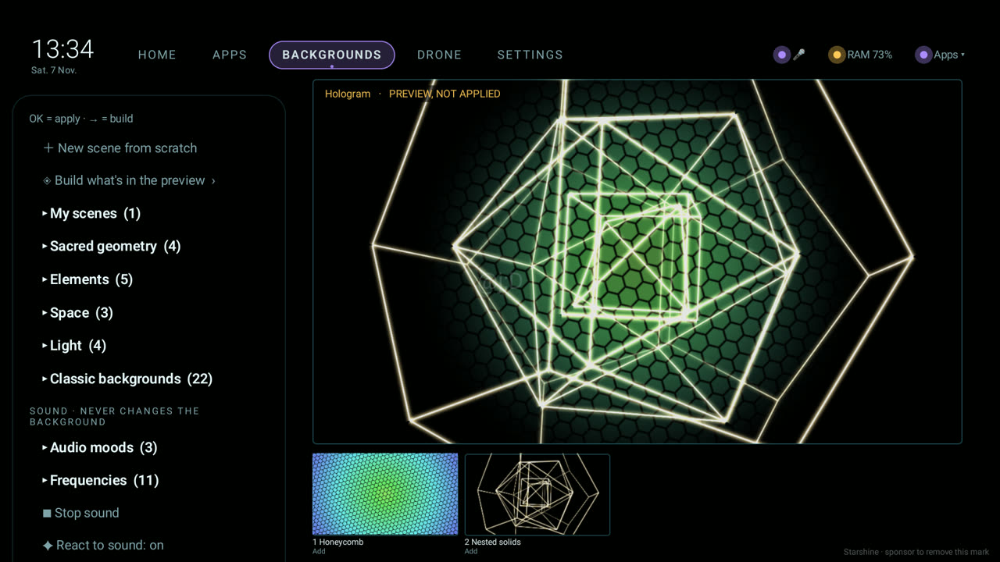

# Starshine for AR glasses

**An all-in-one launcher with visual and audio meditation.** Layered animated visuals, generated soundscapes and frequencies, a home screen and built-in apps, in one place. It's for AR glasses, for your TV, and for your hobbies.

Starshine runs on Android TV boxes and comes with a [Pinokio](https://pinokio.co) toolkit to install and manage it from your PC. On AR glasses such as Rokid, black is see-through, so everything is glowing elements on true black.

**⭐ If you own Rokid or other AR glasses and this is useful to you, please star the repo.** It's the best way to help other owners find it.



## Features

**Layered backgrounds**
- Build flat (2D) scenes from up to 16 layers and 3D space scenes from up to 24, with a live preview of every layer before anything is applied
- Universal particle system (emitters, fields and particle looks, in the spirit of Maya's), with presets such as a spark portal
- Realistic landscapes: openly licensed photos brought to life with gentle sway, mist and light through the leaves
- Visual Meditation journeys: a timeline of scenes and sounds that blend from one step to the next
- Sacred geometry, 3D solids, particles, clouds, fire, water, iris, flares, line visualizers, classic backgrounds, and your own images and videos
- Layers interact: blend modes, mirrors and kaleidoscopes, mask or warp one layer by another
- Sound reaction with selectable sources and targets
- Save, edit and delete your own scenes, and export a video that VLC can play
- 540p, 720p or 1080p rendering



**Sound**
- Audio moods: rain and ocean, generated live in stereo, never looping
- Frequency generator with binaural beats, isochronic pulses, sweeps, noise and a didgeridoo model

**Home screen**
- Dock, app grid, Now Playing, Jellyfin Continue watching, screensaver
- Quick panel of on/off switches, available from any app
- Themes with color presets, ring colors, transparency and fonts
- Global AR dim, glasses safe zone, position and zoom

**Tools**
- File explorer: play in VLC, use as background, copy, delete
- Voice commands with a setup and test screen
- Remote and air-mouse support, 8-direction gestures
- Built-in web viewer

**Experimental**
- Drone tab: live video, recording, immersive and VR dual view, from KY UFO Wi-Fi drones. View only, with no flight control.

See **[HELP.md](HELP.md)** for how everything works. The app shows the same file.

## Current status

This is an early release, developed and tested on one Rokid Station. Known to be unfinished:

- **Drone video** works on one drone so far (KY UFO, 640×352), and other drones are untested
- **AOW M5 air mouse:** in cursor mode its OK is a mouse click, which the Gboard TV keyboard ignores. Use a keyboard that takes clicks, such as the free [LeanKeyboard](https://play.google.com/store/apps/details?id=org.liskovsoft.androidtv.rukeyboard)
- **Video export, spoken voice commands and sound reaction to other apps' audio** haven't been fully tested
- **Head tracking** needs glasses or a box that reports a rotation sensor; the Rokid Station doesn't
- **A full video player and web video takeover** are planned, not built

## Hardware I use

These are the devices it's developed on. Other glasses, boxes and remotes may work too.

- **Rokid Max** AR glasses and **Rokid Station** pod ([Rokid](https://global.rokid.com))
- **AOW M5** air-mouse remote
- **GT3 mini drone**, with the KY UFO app (Wi-Fi name `FLOW-UFO-...`)

## Requirements

- An Android TV device, Android 8 or newer. Developed and tested on a Rokid Station (Android TV 12).
- For the toolkit: a PC running [Pinokio](https://pinokio.co), and ADB network debugging enabled on the device.

## Install

**Ready-made APK:** download `starshine-<version>.apk` from the [latest release](https://github.com/jdeschambeault-code/androidTV_AR/releases/latest), then install it with `adb install -r starshine-<version>.apk`, or copy it to the device and open it with a file manager (allow installing from unknown sources). Later releases install over it and keep your settings.

**With Pinokio (build it yourself):** add this repository's URL to Pinokio, then click:

1. **Install (adb + scrcpy)**
2. **Connect (Wi-Fi ADB)**, entering your device's IP address
3. **Install APK Build Tools**, then **Build & Install Starshine**

**Set it as your home screen:** Tweaks → Home = Starshine.

### Optional personal settings

These stay on your machine and are never committed:

- `config.local.json` holds the device address (saved by Connect) and optional hosts.
- `app/starshine/local.properties` adds your own Jellyfin address, private LAN tiles and domain to your build:

```properties
starshine.jellyfin=http://192.168.1.20:8096
starshine.webTiles=NAS|https://nas.home;Media|https://media.home
starshine.privateDomain=.home
```

`privateDomain` makes the built-in web viewer accept private certificates **for that domain only**. Every other site keeps normal certificate checks. Leave it empty unless you need it.

## Programmatic access

The toolkit wraps `adb`, so any script can drive the device the same way.

**curl**: check a Jellyfin server:
```bash
curl -s http://192.168.1.20:8096/System/Info/Public
```

**Python**: open Starshine and show a scene without applying it:
```python
import subprocess
ADB = "tools/scrcpy/adb"
subprocess.run([ADB, "connect", "192.168.1.50:5555"])
subprocess.run([ADB, "shell", "am", "start", "-n", "com.starshine.launcher/.MainActivity", "--es", "bgPeek", "Water"])
```

**JavaScript**: take a screenshot:
```javascript
const { execFileSync } = require("child_process")
const fs = require("fs")
fs.writeFileSync("screen.png", execFileSync("tools/scrcpy/adb", ["exec-out", "screencap", "-p"], { maxBuffer: 1 << 26 }))
```

## Permissions

Most permissions are granted by the build script and can be revoked in Android settings:

| Permission | Why |
|---|---|
| Microphone | Voice commands, and reading sound levels for sound reaction |
| All files access | File explorer |
| Accessibility service | Taking over the Home button; it only looks at the Home key |
| Notification access | Now Playing card |
| Usage access | Open apps list |
| Wi-Fi changes and location | Joining the drone's network (Android requires location for this) |

No accounts, ads or analytics.

## Support

Starshine shows a faint watermark in the center and a small one in the corner. A **US$10** contribution through [GitHub Sponsors](https://github.com/sponsors/jdeschambeault-code) gets you a support key that removes both, which helps fund development. The source is open, so this works on goodwill.

## Disclaimer

An independent project, not affiliated with Rokid or any drone maker. Tweaks are reversible, but use them at your own risk. Fly drones by direct line of sight and follow local rules. Sounds and visuals are for relaxation and make no health claims. Flashing visuals are limited, but take care if you are photosensitive.
